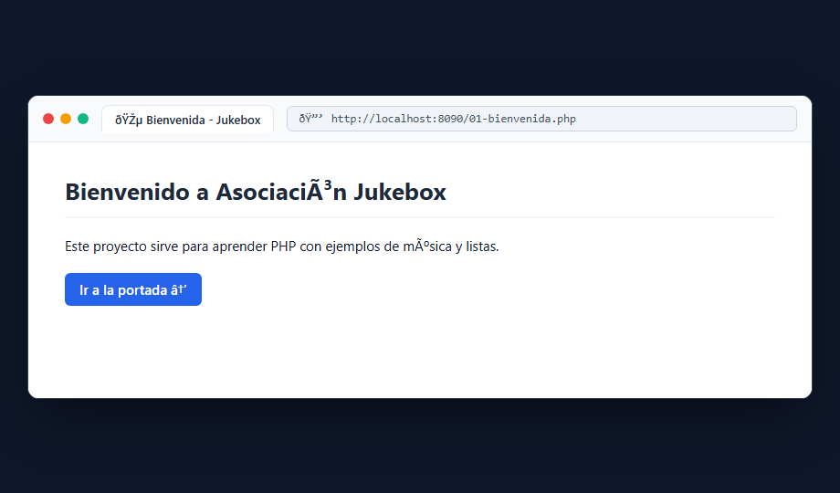
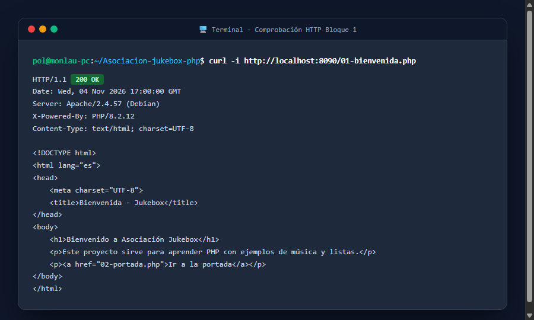

# Bloque 1: Levantar el primer servicio

## 1. ¿Qué hace este bloque? (Objetivo)
Poner en marcha el entorno básico de desarrollo con Docker Compose, ejecutando un servidor web Apache con PHP en el puerto local **8090**. Con esto confirmamos que el servidor responde correctamente a peticiones web y ejecuta archivos PHP.

## 2. Archivos utilizados y explicación sencilla
- **`compose.yaml`**: Define el contenedor Docker (`php:8.2-apache`), mapea el puerto `8090:80` y monta la carpeta de código `src/` en `/var/www/html`.
- **`src/01-bienvenida.php`**: Archivo inicial con un saludo HTML y enlace a la siguiente pantalla para comprobar que el intérprete de PHP y el servidor web funcionan.

## 3. Pruebas y Capturas

### A. Vista en el Navegador
Acceso directo a la URL de comprobación: `http://localhost:8090/01-bienvenida.php`



### B. Verificación por Terminal (`curl`)
Comprobamos el código de estado HTTP `200 OK` y las cabeceras de respuesta del servidor:

```bash
curl -i http://localhost:8090/01-bienvenida.php
```



## 4. Resultado
El servidor responde con código **HTTP 200 OK** y entrega la página web correctamente procesada.
