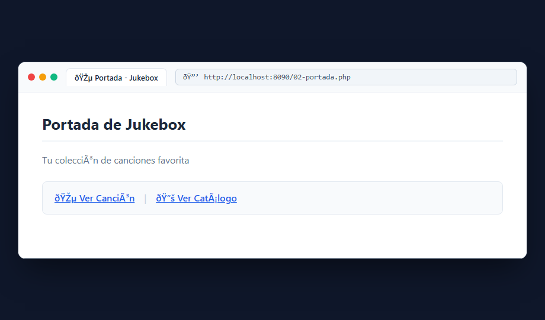
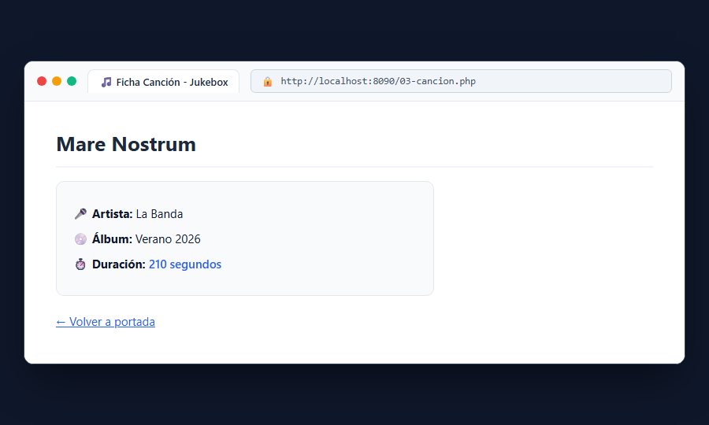

# Bloque 2: Describir la primera canción

## 1. ¿Qué hace este bloque? (Objetivo)
Crear la estructura visual de la portada del Jukebox y una ficha descriptiva para una canción utilizando variables PHP, arrays asociativos y protección básica contra inyección de código (XSS) mediante `htmlspecialchars()`.

## 2. Archivos utilizados y explicación sencilla
- **`src/02-portada.php`**: Página principal con cabecera dinámica (`$title`, `$subtitle`) y menú de navegación hacia la canción y el catálogo.
- **`src/03-cancion.php`**: Define una canción como un array asociativo con datos de `titulo`, `artista`, `album` y `duracion` en segundos, renderizándolos en una ficha informativa en pantalla.

### Seguridad XSS:
Para evitar que un usuario o dato externo inyecte etiquetas maliciosas (ej. `<script>` o `<b>`), el contenido dinámico se escapa con:
```php
htmlspecialchars($texto, ENT_QUOTES | ENT_SUBSTITUTE, 'UTF-8')
```

## 3. Pruebas y Capturas

### A. Portada Principal (`02-portada.php`)
Accedemos a `http://localhost:8090/02-portada.php` donde vemos el título del jukebox y los enlaces de navegación.



### B. Ficha de la Canción (`03-cancion.php`)
Accedemos a `http://localhost:8090/03-cancion.php` para visualizar los datos cargados desde el array de PHP.



## 4. Resultado
El HTML se entrega limpio al navegador sin exponer el código fuente PHP del servidor y con los datos protegidos contra inyecciones.
