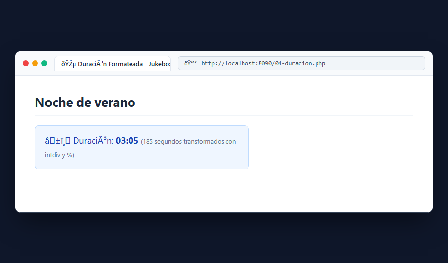
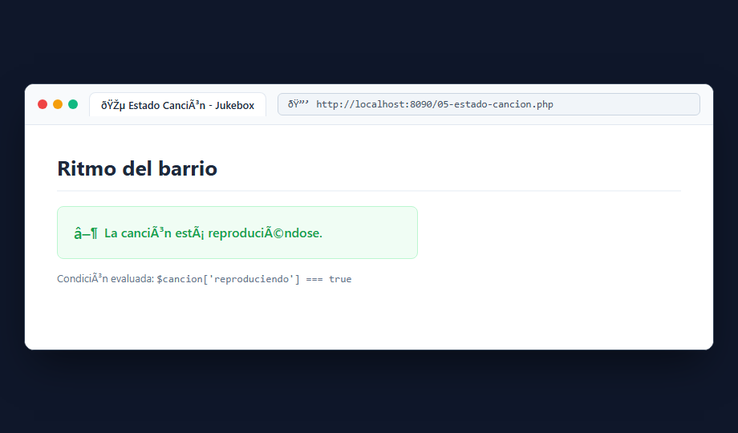

# Bloque 3: Calcular y decidir sobre una canción

## 1. ¿Qué hace este bloque? (Objetivo)
Aprender a realizar operaciones aritméticas para transformar unidades (de segundos a minutos:segundos) y aplicar lógica condicional (`if / else`) para tomar decisiones basadas en el estado de una pista musical, usando comparación estricta (`===`).

## 2. Archivos utilizados y explicación sencilla
- **`src/04-duracion.php`**: Define la función `formatoDuracion(int $segundos)`. Emplea:
  - `intdiv($segundos, 60)` para obtener los minutos enteros.
  - `$segundos % 60` (operador resto) para calcular los segundos restantes.
  - `sprintf('%02d:%02d', ...)` para formatear con dos dígitos (ej. 185 segundos -> `03:05`).
- **`src/05-estado-cancion.php`**: Evalúa una bandera booleana (`'reproduciendo' => true`). Si está activa muestra el mensaje en verde; de lo contrario, indica que está en pausa.

### Comparación estricta (`===`):
Se usa `===` en lugar de `==` para garantizar que coincidan tanto el **valor** como el **tipo de dato** (evitando que el número `185` coincida falsamente con el texto `'185'`).

## 3. Pruebas y Capturas

### A. Duración Formateada (`04-duracion.php`)
Acceso a `http://localhost:8090/04-duracion.php` mostrando la transformación de 185s en formato musical `03:05`.

### B. Estado de Reproducción (`05-estado-cancion.php`)
Acceso a `http://localhost:8090/05-estado-cancion.php` evaluando la condición `reproduciendo === true`.

## 4. Resultado
Las operaciones matemáticas y las condiciones se evalúan con precisión sin conversiones implícitas de tipo.
