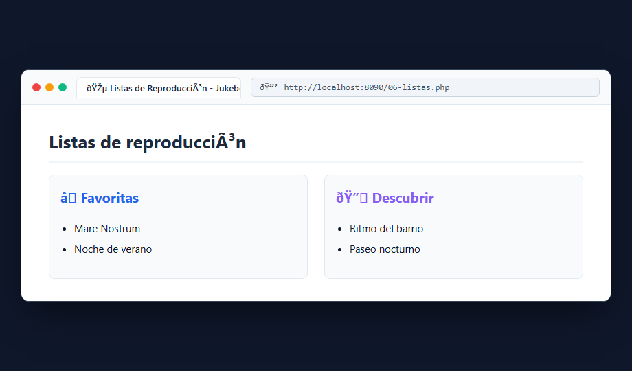
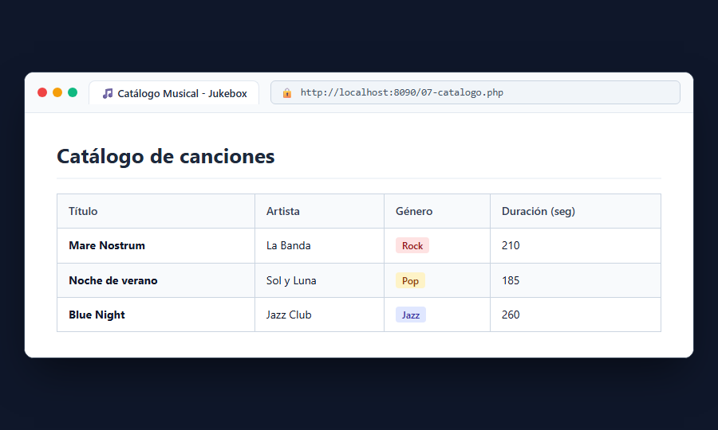

# Bloque 4: Construir el catálogo musical

## 1. ¿Qué hace este bloque? (Objetivo)
Aprender a gestionar colecciones de datos (arrays multidimensionales) y recorrerlas dinámicamente mediante bucles (`foreach`) para presentar listas de reproducción y una tabla completa con el catálogo de canciones.

## 2. Archivos utilizados y explicación sencilla
- **`src/06-listas.php`**: Define un array asociativo con dos listas de reproducción ("Favoritas" y "Descubrir"). Utiliza un bucle `foreach` anidado para mostrar el nombre de la lista y cada una de las canciones que contiene en elementos `<ul>` y `<li>`.
- **`src/07-catalogo.php`**: Carga una colección de canciones desde `lib/catalogo-inicial.php` y recorre cada elemento para generar una tabla HTML (`<table>`) con columnas para Título, Artista, Género y Duración.

### Validación de catálogo vacío:
Si la colección estuviese vacía (`empty($catalogo)`), se muestra un mensaje informativo indicando *"Todavía no hay canciones"* antes de intentar ejecutar el bucle.

## 3. Pruebas y Capturas

### A. Listas de Reproducción (`06-listas.php`)
Acceso a `http://localhost:8090/06-listas.php` mostrando las agrupaciones de pistas.

### B. Tabla del Catálogo Musical (`07-catalogo.php`)
Acceso a `http://localhost:8090/07-catalogo.php` mostrando la tabla con todos los registros del array.

## 4. Resultado
Se generan tablas y listas dinámicas sin duplicar etiquetas HTML manualmente.
