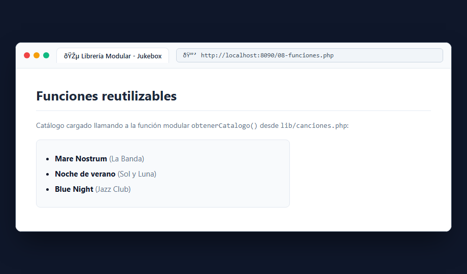

# Bloque 5: Separar funciones y datos (Modularización)

## 1. ¿Qué hace este bloque? (Objetivo)
Modularizar la aplicación organizando el código en librerías independientes y reutilizables. En lugar de escribir todas las funciones y datos en el mismo archivo, separamos la lógica en carpetas dedicadas (`src/lib/`) y las importamos con `require` / `require_once`.

## 2. Archivos utilizados y explicación sencilla
- **`src/lib/canciones.php`**: Contiene la función `obtenerCatalogo()`, que devuelve el array estructurado con las canciones disponibles.
- **`src/lib/catalogo-inicial.php`**: Almacena datos estáticos base del catálogo musical.
- **`src/08-funciones.php`**: Archivo principal que incluye la librería externa usando `require __DIR__ . '/lib/canciones.php'` y renderiza las canciones obtenidas.

### ¿Por qué `require_once` en lugar de `include`?
`require_once` detiene la ejecución inmediatamente con un **Fatal error** si el archivo solicitado no existe, evitando que la aplicación continúe funcionando en un estado corrupto o incompleto. Además, garantiza que un archivo no se cargue dos veces por accidente.

## 3. Pruebas y Capturas

### Vista de Funciones Reutilizables (`08-funciones.php`)
Acceso a `http://localhost:8090/08-funciones.php` donde comprobamos que los datos se cargan llamando a la función modular `obtenerCatalogo()`.

## 4. Resultado
El código queda limpio, desacoplado y preparado para crecer sin duplicar funciones ni arrays en múltiples pantallas.
