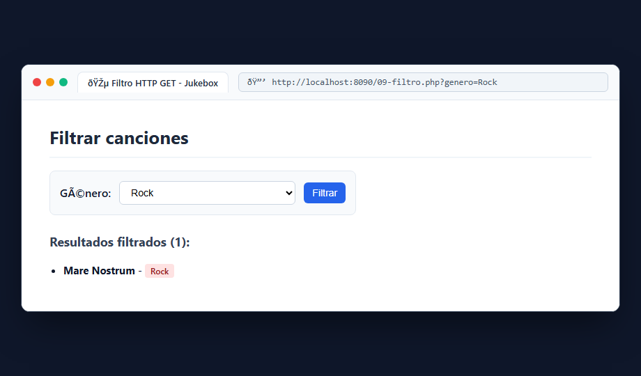
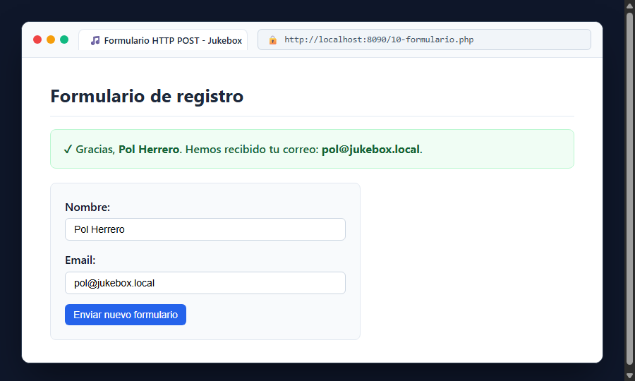

# Bloque 6: Recibir peticiones HTTP (GET y POST)

## 1. ¿Qué hace este bloque? (Objetivo)
Gestionar la interacción con el usuario procesando entradas enviadas a través del protocolo HTTP. Se aprende a leer parámetros desde la URL con `$_GET` para filtrar resultados y a procesar formularios enviados con `$_POST` validando los datos recibidos.

## 2. Archivos utilizados y explicación sencilla
- **`src/09-filtro.php`**: Permite al usuario seleccionar un género musical (Pop, Rock, Jazz o Todos) mediante un desplegable `<select>`. El formulario se envía con `method="get"`, capturando el parámetro `$_GET['genero']` y aplicando `array_filter` para filtrar el catálogo.
- **`src/10-formulario.php`**: Formulario de contacto/registro enviado por `method="post"`. Lee los campos `$_POST['nombre']` y `$_POST['email']`, verifica que no estén vacíos y muestra un mensaje de confirmación seguro protegiendo los datos con `htmlspecialchars()`.

### Matriz de comportamiento GET (`09-filtro.php`):
| Petición / Parámetro | Estado HTTP | Resultado |
| :--- | :--- | :--- |
| `/09-filtro.php` | `200 OK` | Muestra todo el catálogo |
| `/09-filtro.php?genero=Rock` | `200 OK` | Muestra exclusivamente las canciones de Rock |
| `/09-filtro.php?genero=Pop` | `200 OK` | Muestra exclusivamente las canciones de Pop |

## 3. Pruebas y Capturas

### A. Filtrado por Parámetro GET (`09-filtro.php?genero=Rock`)
Comprobamos el filtro seleccionando "Rock" en el desplegable.

### B. Envío de Formulario POST con Validación (`10-formulario.php`)
Comprobamos el envío rellenando Nombre y Email, recibiendo la confirmación sanitizada.

## 4. Resultado
La aplicación recibe datos del cliente tanto por URL como por el cuerpo de la petición sin errores y de manera segura.
