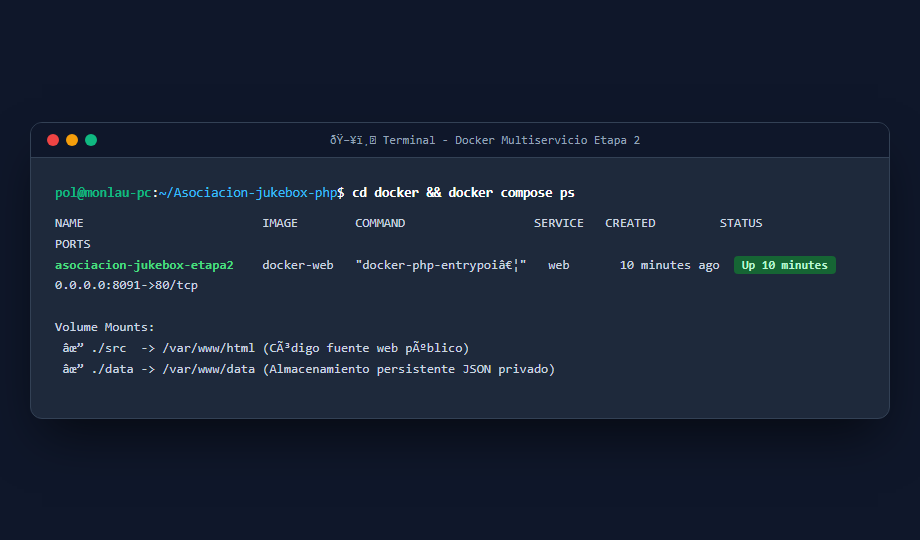
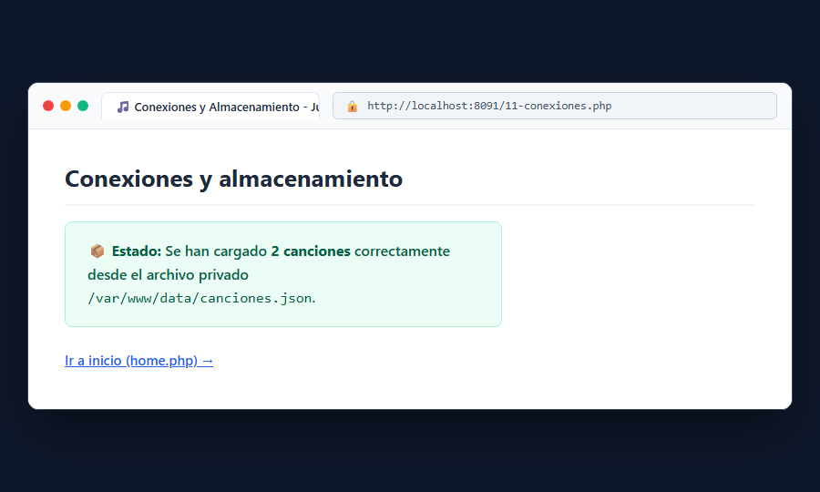

# Bloque 7: Preparar la segunda etapa de Docker

## 1. ¿Qué hace este bloque? (Objetivo)
Configurar la arquitectura avanzada de la **Etapa 2**, levantando un entorno multiservicio en el puerto **8091** con configuración personalizada de Apache (VirtualHost) y un volumen de datos persistente privado (`/var/www/data`) que queda fuera del alcance web directo por motivos de seguridad.

## 2. Archivos utilizados y explicación sencilla
- **`docker/compose.yaml`**: Define el servicio `web` expuesto en el puerto `8091:80`, montando dos volúmenes:
  - `./src` en `/var/www/html` (código fuente público).
  - `./data` en `/var/www/data` (datos persistentes protegidos).
- **`docker/Dockerfile`**: Construye la imagen con extensiones avanzadas de PHP y configuración personalizada de Apache.
- **`docker/apache/jukebox.conf`**: Archivo de VirtualHost que fija el `DocumentRoot` en `/var/www/html`.
- **`docker/src/11-conexiones.php`**: Script de verificación que comprueba que PHP puede acceder y leer los datos alojados en la ruta privada `/var/www/data/canciones.json`.

## 3. Pruebas y Capturas

### A. Verificación del Contenedor Activo por Terminal
Ejecutamos `cd docker && docker compose ps` para comprobar que el contenedor `asociacion-jukebox-etapa2` está funcionando en el puerto 8091:

### B. Comprobación de Acceso al Almacenamiento Privado (`11-conexiones.php`)
Accedemos a `http://localhost:8091/11-conexiones.php` para verificar que PHP lee con éxito el archivo JSON desde `/var/www/data/`.

## 4. Resultado
El servidor de la Etapa 2 está listo en el puerto 8091 con los archivos de datos protegidos adecuadamente fuera del árbol web público.
