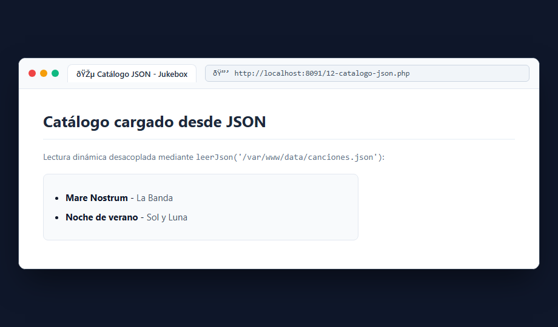
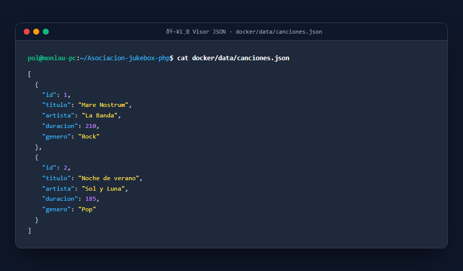

# Bloque 8: Leer el catálogo desde JSON

## 1. ¿Qué hace este bloque? (Objetivo)
Desacoplar los datos del código PHP almacenando la colección musical en un archivo externo en formato **JSON** (`canciones.json`). Aprendemos a leer el archivo, decodificarlo a un array de PHP y mostrarlo en la interfaz.

## 2. Archivos utilizados y explicación sencilla
- **`docker/data/canciones.json`**: Archivo que guarda el listado de canciones con su estructura (`id`, `titulo`, `artista`, `duracion`, `genero`).
- **`docker/src/lib/almacen-json.php`**: Librería que define las funciones de persistencia:
  - `leerJson(string $ruta)`: Lee el contenido con `file_get_contents()` y lo convierte a array asociativo con `json_decode($contenido, true)`. Si el archivo no existe o está vacío, devuelve `[]`.
  - `guardarJson(string $ruta, array $datos)`: Convierte el array a JSON formateado (`JSON_PRETTY_PRINT | JSON_UNESCAPED_UNICODE`) y lo guarda con `file_put_contents()`.
- **`docker/src/12-catalogo-json.php`**: Página que llama a `leerJson()` y renderiza la lista de canciones en viñetas `<ul>` y `<li>`.

## 3. Pruebas y Capturas

### A. Vista del Catálogo Dinámico desde JSON (`12-catalogo-json.php`)
Acceso a `http://localhost:8091/12-catalogo-json.php` mostrando las canciones cargadas dinámicamente desde el archivo de persistencia.

### B. Contenido Estructurado de `canciones.json`
Visualización del archivo persistente en el servidor:

## 4. Resultado
Los datos ya no dependen de variables fijas en el código: cualquier cambio en `canciones.json` se refleja automáticamente en la web.
