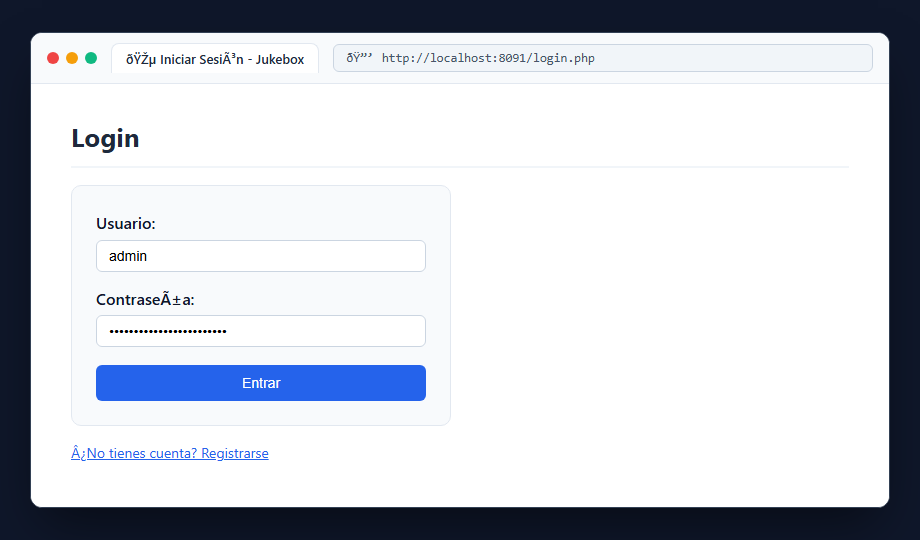
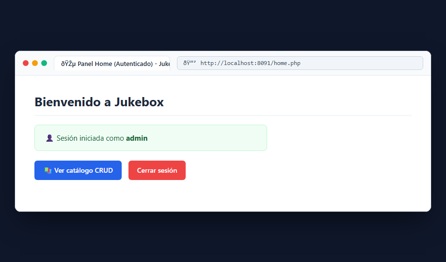

# Bloque 9: Sesiones, Registro y Login

## 1. ¿Qué hace este bloque? (Objetivo)
Gestionar la autenticación de usuarios y el control de sesiones mediante `$_SESSION`. Permite registrar usuarios, iniciar sesión, verificar credenciales y restringir el acceso a páginas privadas redirigiendo a los visitantes no autenticados.

## 2. Archivos utilizados y explicación sencilla
- **`docker/src/lib/sesion.php`**: Inicializa la sesión con `session_start()`.
- **`docker/src/lib/acceso.php`**:
  - `requireLogin()`: Comprueba si existe `$_SESSION['login'] === true`. Si no está presente, redirige a `login.php` y detiene la ejecución con `exit`.
  - `usuarioActual()`: Devuelve el nombre del usuario conectado almacenado en `$_SESSION['usuario']`.
- **`docker/src/login.php`**: Formulario de acceso. Comprueba que el usuario y la contraseña no estén vacíos y registra la sesión activa.
- **`docker/src/register.php`**: Formulario para darse de alta como nuevo usuario.
- **`docker/src/home.php`**: Página principal privada. Saluda al usuario conectado y ofrece enlaces a cerrar sesión o gestionar canciones.
- **`docker/src/logout.php`**: Destruye la sesión del servidor y redirige a la pantalla de entrada.

## 3. Pruebas y Capturas

### A. Pantalla de Inicio de Sesión (`login.php`)
Acceso a `http://localhost:8091/login.php` donde el usuario introduce sus credenciales (`admin` / clave).

### B. Panel Privado con Sesión Activa (`home.php`)
Tras autenticarse con éxito, se redirige a `home.php` mostrando el saludo personalizado y el estado de la sesión.

## 4. Resultado
Las páginas privadas quedan protegidas: cualquier intento de entrar directamente a la gestión sin sesión activa redirige inmediatamente al login.
