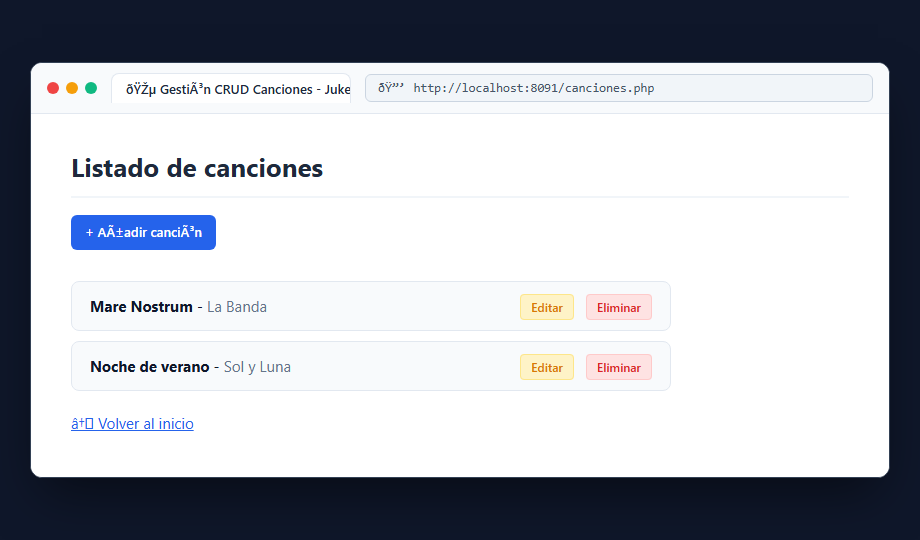
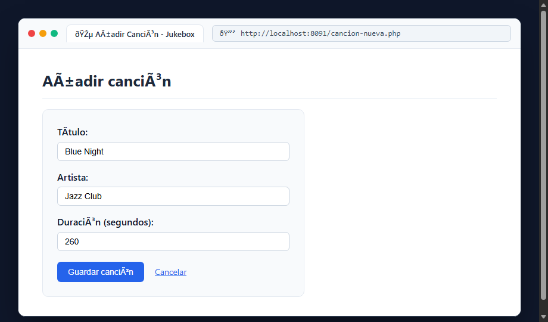

# Bloque 10: Consultar y gestionar canciones (CRUD)

## 1. ¿Qué hace este bloque? (Objetivo)
Implementar un sistema completo de **CRUD** (*Create, Read, Update, Delete*) para que los usuarios autenticados puedan consultar el catálogo, registrar nuevas pistas, editarlas y eliminarlas con persistencia real sobre el archivo `canciones.json`.

## 2. Archivos utilizados y explicación sencilla
- **`docker/src/canciones.php` (Read)**: Muestra el listado de todas las canciones guardadas, con botones de acción para *Añadir canción*, *Editar* y *Eliminar*. Requiere inicio de sesión previo (`requireLogin()`).
- **`docker/src/cancion-nueva.php` (Create)**: Formulario de alta. Valida que los campos no vengan vacíos, calcula automáticamente el siguiente identificador único:
  ```php
  $nuevoId = count($canciones) ? max(array_column($canciones, 'id')) + 1 : 1;
  ```
  y guarda la canción en el archivo JSON.
- **`docker/src/cancion-editar.php` (Update/Detalle)**: Busca la canción por su ID (`$_GET['id']`) y muestra sus detalles para modificarla o confirmarla.
- **`docker/src/cancion-eliminar.php` (Delete)**: Filtra el array eliminando la canción con el ID indicado y utiliza `array_values()` para reconstruir los índices numéricos, asegurando que el JSON exportado se mantenga como un array válido y ordenado.

## 3. Pruebas y Capturas

### A. Listado General con Acciones CRUD (`canciones.php`)
Acceso a `http://localhost:8091/canciones.php` con el listado de pistas y botones de gestión.



### B. Formulario de Alta de Canción (`cancion-nueva.php`)
Acceso a `http://localhost:8091/cancion-nueva.php` con los campos Título, Artista y Duración.



## 4. Resultado
El sistema gestiona el ciclo de vida completo de las canciones sin corromper el archivo JSON ni duplicar identificadores.
