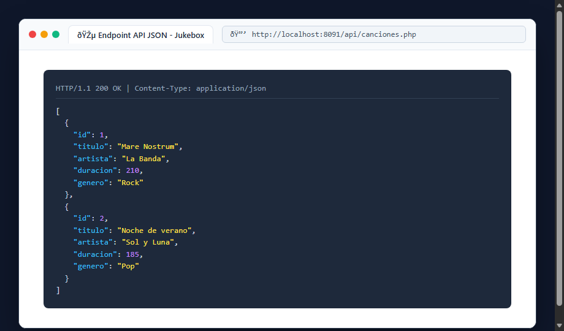
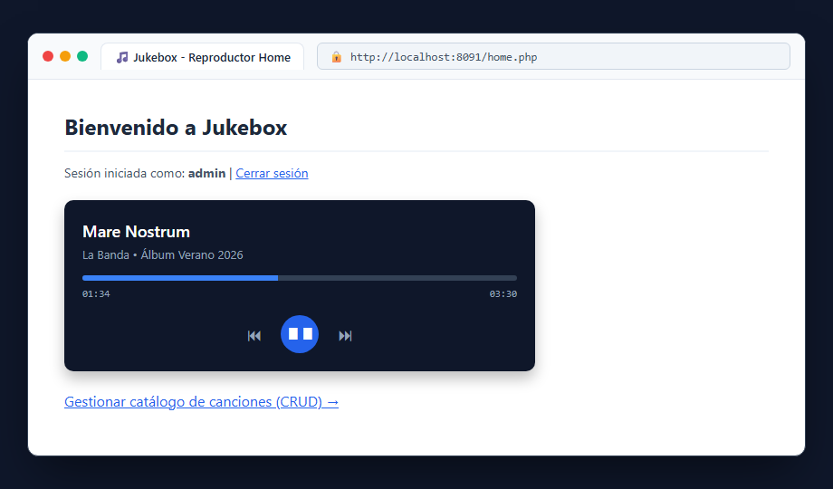

# Bloque 11: Conectar el jukebox a la home

## 1. ¿Qué hace este bloque? (Objetivo)
Integrar la experiencia interactiva del reproductor de música en la pantalla principal (`home.php`), consumiendo los datos de las canciones a través de un endpoint **API JSON** expuesto por el servidor PHP.

## 2. Archivos utilizados y explicación sencilla
- **`docker/src/api/canciones.php`**: Actúa como servicio web / API REST. Configura la cabecera HTTP:
  ```php
  header('Content-Type: application/json');
  ```
  Lee la colección desde `canciones.json` y la emite codificada en JSON nativo mediante `json_encode()`.
- **`docker/src/home.php`**: Panel principal que integra los controles multimedia (reproducir, pausar, siguiente/anterior pista y barra de progreso) permitiendo escuchar las canciones cargadas dinámicamente desde el servidor.

## 3. Pruebas y Capturas

### A. Endpoint API JSON (`api/canciones.php`)
Petición directa a `http://localhost:8091/api/canciones.php` recibiendo la respuesta con formato y tipo MIME JSON.



### B. Reproductor Interactivo en la Home (`home.php`)
Visualización de la interfaz del Jukebox en `http://localhost:8091/home.php` con la pista actual en reproducción.



## 4. Resultado
El front-end y el backend se comunican limpiamente mediante formato estándar JSON, logrando una experiencia musical completa.
