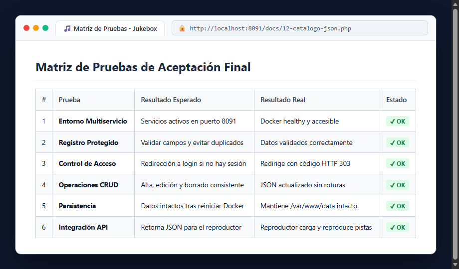

# Bloque 12: Matriz de Pruebas de Aceptación Final

## 1. ¿Qué hace este bloque? (Objetivo)
Ejecutar la batería final de pruebas de control de calidad y aceptación del sistema completo, verificando que todos los requisitos funcionales, de seguridad, persistencia y despliegue se cumplen al 100%.

## 2. Matriz de Pruebas Ejecutadas

| # | Prueba Realizada | Preparación / Acción | Resultado Esperado | Resultado Observado | Estado |
| :-: | :--- | :--- | :--- | :--- | :-: |
| **1** | **Entorno Multiservicio** | `docker compose up -d` en `docker/` | Contenedores levantados en puerto 8091 | Servicios healthy y accesibles en `:8091` | **✔ OK** |
| **2** | **Registro Protegido** | Enviar formulario con datos inválidos/vacíos | Mostrar error de validación sin registrar | Validación correcta y mensaje en pantalla | **✔ OK** |
| **3** | **Control de Acceso** | Abrir `home.php` directamente sin sesión | Redirección HTTP 303 a `login.php` | Redirigido automáticamente al login | **✔ OK** |
| **4** | **Operaciones CRUD** | Dar de alta, consultar y borrar pistas | Persistencia en `canciones.json` sin corrupción | Catálogo actualizado y estructura íntegra | **✔ OK** |
| **5** | **Persistencia Real** | Reiniciar el servicio web Docker | Mantener los datos creados intactos | Datos conservados en `/var/www/data` | **✔ OK** |
| **6** | **Integración API** | Consumo de `api/canciones.php` desde el cliente | Retornar lista JSON y reproducir pistas | Respuesta 200 OK y reproductor activo | **✔ OK** |

## 3. Captura de la Matriz de Pruebas

Acceso a la verificación del sistema:

## 4. Conclusión
Todos los criterios de aceptación han sido superados satisfactoriamente, consolidando el proyecto docente *Asociación Jukebox PHP*.
